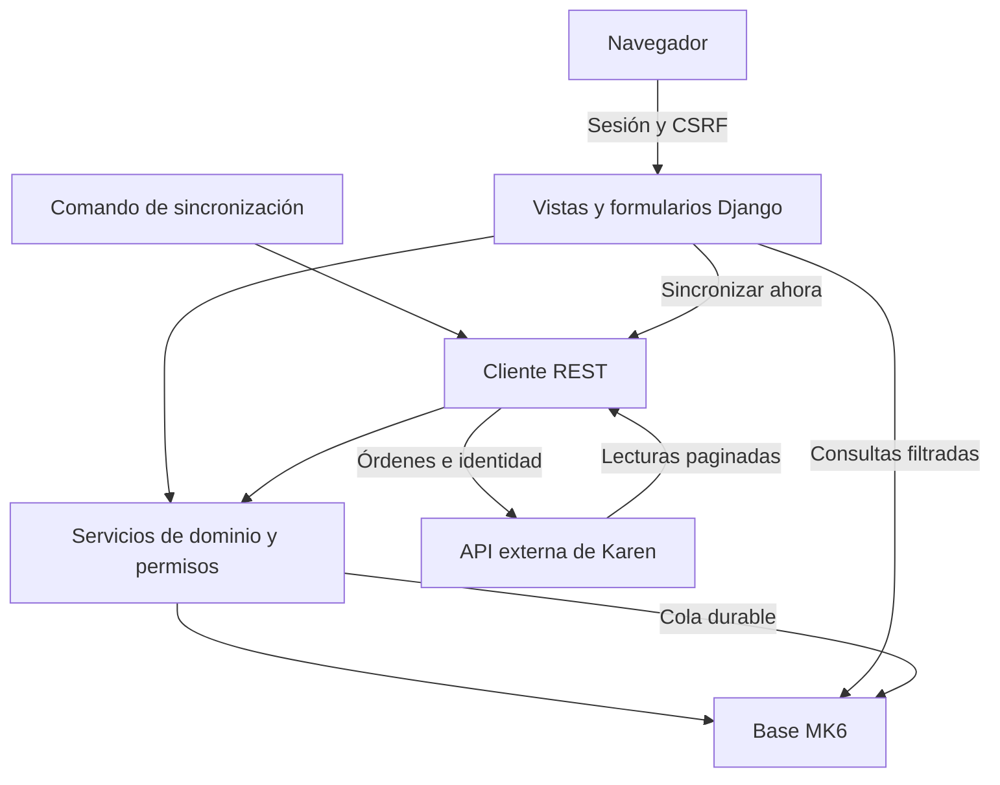

# Arquitectura y manual técnico — MK6

## Cambio tecnológico

MK5 usa Java 21, Spring Boot, Thymeleaf, sesiones y BCrypt sobre MySQL. MK6 implementa los mismos dominios en Python/Django con templates, sesiones, ORM, servicios transaccionales y migraciones. Los recursos visuales originales se conservan; las vistas se adaptan a Django y se completan los módulos nuevos. No se ejecuta el backend Java ni su generador periódico.

El paquete incluye código completo de la aplicación Django. La generación artificial pertenece a un servicio externo, pendiente de la implementación/despliegue de Karen. El adaptador está disponible sin exigir esa conexión para abrir el sitio.

## Componentes y límites



Django es el consumidor. Su base no comparte tablas con la API externa. La cola guarda solicitudes de registro, activación y detención; la API debe ejecutarlas de forma idempotente. El navegador nunca recibe secretos del proveedor.

## Estructura y responsabilidades

| Ubicación | Responsabilidad |
|---|---|
| `manage.py`, `config/` | Arranque, configuración por entorno, sesiones, seguridad, URL raíz y WSGI. |
| `apps/usuarios/` | Usuario por correo, roles, backend BCrypt/PBKDF2, permisos y comandos de demo/migración. |
| `apps/empresas/` | Identidad empresarial, estado de cuenta, vigencia/cupos y cierre de monitoreos. |
| `apps/suscripciones/` | Planes, solicitudes, pagos simulados, revisión, renovación y vencimiento. |
| `apps/apiario/` | Colmenas, sensores, intervalos de asociación, producción y numeración. |
| `apps/monitoreo/` | Intervalos de monitoreo, lecturas, umbrales, alertas y notificaciones. |
| `apps/integraciones/` | Configuración de conexión sin secretos persistidos, cola, cliente REST y sincronizador. |
| `apps/importaciones/` | Lectura CSV/XLSX, lotes, vista previa, confirmación, duplicados y errores. |
| `apps/auditoria/` | Registro técnico de acciones y entidades. |
| `apps/comun/` | Errores de negocio, acceso y campos de unicidad condicional. |
| `apps/web/` | Vistas, forms con campos permitidos, consultas filtradas, estadísticas y archivos exportados. |
| `templates/` | Portada, autenticación, panel interno, panel cliente y componentes compartidos. |
| `static/` | CSS y logos heredados, ajustes MK6, gráficos JS e iconos locales. No depende de un CDN para iconos. |
| `tests/` | Pruebas de negocio, seguridad, aislamiento, integración, importación y archivos. |
| `database/` | SQL de una instalación vacía, generado y restaurado como verificación. |
| `docs/`, `Requisitos_Historias_MK6.md`, `Ejecutar` | Documentación funcional, técnica y ejecución. |

## Autenticación y aislamiento

`CorreoBackend` autentica por correo y contraseña. El usuario cliente debe corresponder a la empresa validada por NIT; después el tenant se obtiene de `request.user.empresa`. Ni company_id enviado por formulario ni una PK adivinada determinan el acceso. El backend también admite el campo username del formulario técnico de Django, usando el correo como identidad.

`requiere_permiso` y `exigir` protegen vistas y servicios. Los `ModelForm` solo aceptan campos permitidos. Los querysets de detalle, listas, filtros y exportación incorporan empresa. El personal interno tiene sus módulos administrativos separados. Sesiones, CSRF, autoescape y ORM parametrizado protegen operaciones comunes.

Las validaciones de servicio se complementan con FK, checks, únicos y 22 triggers SQL para empresas/identidades. No basta con `Model.clean()` porque `update()` y `bulk_create()` pueden omitirlo. Los triggers bloquean también cambios directos de relaciones que trasladarían historial entre empresas.

## Identidad y archivo de colmenas

`Colmena.id` es permanente. `numero` es un número visible único dentro de una empresa; al archivar pasa a NULL y queda copiado en `numero_historico`. La creación bloquea la fila Empresa y asigna el menor positivo libre. Así dos altas concurrentes en MySQL/MariaDB se serializan por empresa; el índice único sirve de respaldo.

Archivar cierra los monitoreos y asociaciones, encola detenciones y conserva lecturas/cosechas/alertas. Nunca se reinicia AUTO_INCREMENT, nunca se modifica la PK y no se renumeran colmenas vivas. Los ejemplos 1/2/3 reutilizados funcionan sin cruzar datos porque los enlaces y las lecturas usan PK y asociación, no solo el número visible.

## Ingreso de mediciones y alertas

`registrar_medicion` es la entrada validada de API/importaciones. Valida número finito, tamaño decimal, humedad/peso, unidad, tipo, origen, zona horaria, fecha y asociación/monitoreo en ese instante. Los intervalos son `[inicio, fin)`: la fecha final ya no pertenece a la asociación cerrada.

La identidad idempotente es `(sensor, fuente, id_externo)`; la fuente separa los IDs de API, importación y traslado. El mismo ID con valor o fecha diferentes es conflicto. Las lecturas retrasadas pueden guardarse en su asociación histórica; no se reasignan al último destino del sensor. Una lectura antigua no genera una alerta atrasada si ya hay una posterior en esa asociación/tipo.

El umbral empresarial activo tiene prioridad sobre el global. Una alerta toma una copia de mínimo/máximo, valor y severidad. Sin umbral no se inventa un rango nuevo. La combinación de transacción e índice evita alertas activas repetidas por colmena/tipo.

```mermaid
sequenceDiagram
    participant C as "Consumidor Django"
    participant A as "API externa"
    participant S as "Servicio de mediciones"
    participant D as "Base MK6"
    C->>A: "GET lecturas del sensor y cursor"
    A-->>C: "Página con identidades"
    C->>D: "Bloquear sensor y comprobar cursor"
    loop "Cada lectura de la página"
        C->>S: "Validar empresa, relación, tiempo y valor"
        S->>D: "Guardar lectura y alerta si corresponde"
    end
    alt "Página válida"
        C->>D: "Guardar cursor y confirmar"
    else "Fila incompatible"
        C->>D: "Revertir página; conservar cursor anterior"
    end
```

## Importación y exportación

La vista previa ejecuta las mismas reglas dentro de una transacción que se revierte. Después conserva el lote (filas y errores) separado de los datos de negocio. La confirmación bloquea ese lote, revalida todo y utiliza un savepoint por fila: filas válidas se guardan y las inválidas quedan reportadas. Repetir la confirmación del mismo lote falla de forma controlada.

En históricos se normaliza instante UTC/valor decimal. Una lectura existente del mismo sensor e instante se reutiliza si coincide; datos diferentes se rechazan. La cosecha importada se identifica por colmena e instante y puede incorporarse aunque la lectura exista. Los modelos conservan la procedencia original de esa lectura.

Límites: archivo 5 MB, XLSX expandido 25 MB, 2000 filas, exportación hasta 10000 registros. Los archivos de negocio no crean código ni ejecutan macros. CSV/XLSX neutralizan fórmulas en texto; XLSX conserva números. PDF usa ReportLab y escapa texto para evitar interpretación de marcado de entrada.

## Pagos y concurrencia

El portal conserva el alcance **simulado** del MK5. La solicitud pública retiene cuatro dígitos ficticios; no almacena tarjeta completa ni procesa cobros reales. El importe viene del plan.

La revisión bloquea el pago y la empresa. Confirmar un pago procesado se rechaza. Una renovación del mismo plan cancela/vuelve vencida la suscripción anterior y crea una nueva activa, conservando días pendientes. Un índice condicional garantiza una sola activa por empresa. Cambio de plan antes del vencimiento se rechaza para no perder o inventar saldo.

El pago pendiente no se interpreta como ingreso verificado. La cuenta empresarial y la vigencia de suscripción son estados separados. `vencer_suscripciones` marca vencidas y cierra intervalos con órdenes externas de detención.

## Configuración y operación

La instalación detallada está en `Ejecutar`. `DB_ENGINE=sqlite` sirve para explorar. El destino verificado es MariaDB usando el backend MySQL de Django; requisitos mínimos del paquete: MariaDB 10.5+ o MySQL 8.0.16+. MariaDB 10.4 de XAMPP no es compatible. El código no configura PostgreSQL en esta entrega.

En desarrollo se usan dos procesos: `runserver` y, cuando exista proveedor configurado, `sincronizar_sensores --continuo --intervalo 60`. La tarea de vencimientos puede ejecutarse diariamente. En producción deben supervisarse con el servicio de procesos del sistema/hosting, y Django debe servirse por WSGI con HTTPS y estáticos recolectados. No se usa `runserver` como servidor público.

`.env` conserva secretos locales y está excluido de Git. Hay configuración por empresa `SENSOR_API_URL_<id>`/`SENSOR_API_TOKEN_<id>`. Reiniciar procesos cuando cambie. El token no se guarda en las tablas ni en el contexto HTML.

## Mantenimiento y cambios de modelo

1. Trabajar en rama de Git y coordinar propiedad del archivo con el equipo.
2. Cambiar modelo y generar migración; revisar SQL y dependencias.
3. Si se reconstruye una tabla SQLite referenciada por triggers, retirar/recrear esos triggers dentro de la migración. La instalación inicial ya los crea después de las tablas y restricciones.
4. Ejecutar `check`, `makemigrations --check --dry-run` y pruebas pertinentes en el motor objetivo.
5. Revisar permisos, requerimientos, contrato y manuales afectados.
6. Respaldar y probar la migración en una copia antes de actualizar una instalación con datos.

El SQL distribuido es la fotografía inicial de estas migraciones. Los siguientes cambios de código se despliegan con migraciones, no reimportando ese SQL sobre una base existente. La entrega sustituye un backend MK5; no se presenta como actualización directa de la base de la versión Django preliminar de Claude.

## Fuentes técnicas verificadas

- Django 5.2, bases de datos: https://docs.djangoproject.com/en/5.2/ref/databases/
- Django 5.2, instalación: https://docs.djangoproject.com/en/5.2/topics/install/
- Fuente de MK5: `ApiMK5 (1)(1).zip`, carpeta `database/schema.sql`, código Java y recursos estáticos.
- Documentos de 43 historias y RF/RNF aportados por el equipo. Correspondencia en `Trazabilidad_MK5_MK6.md`.
