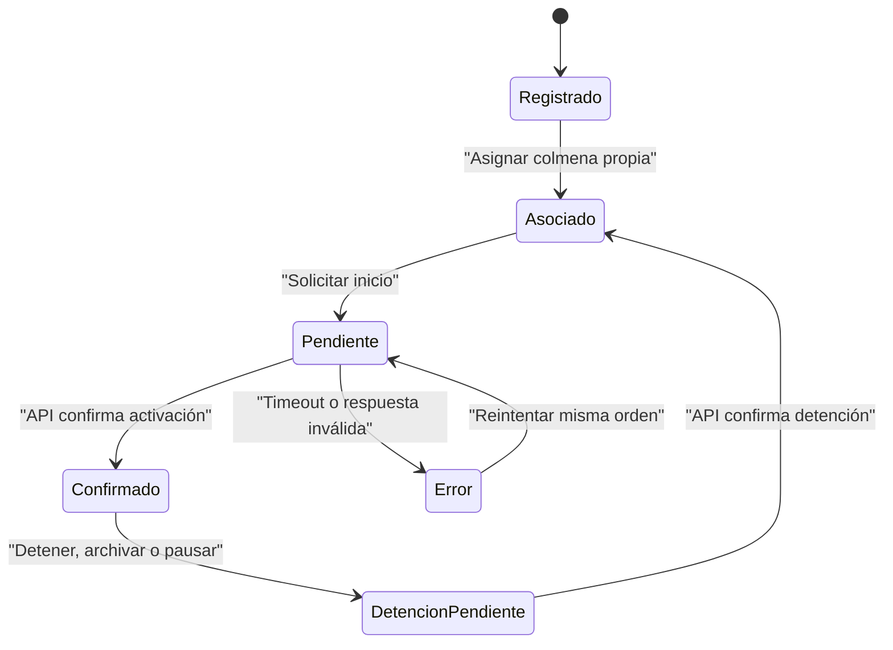

# Casos de uso y escenarios de aceptación MK6

La especificación normativa es `../Requisitos_Historias_MK6.md`. Esta síntesis describe flujos operativos; los identificadores HU del inventario original se conservan allí. Actores humanos: cuatro roles ApiTech/cliente. Actor externo: servicio REST de sensores. No hay un actor humano o rol Sistema.

| Caso | Actor | Precondición | Flujo principal | Alternativa y resultado |
|---|---|---|---|---|
| CU01 · Acceder | Usuario | Cuenta activa | Elegir acceso; cliente valida NIT; ingresar correo/contraseña; abrir panel del rol. | NIT ajeno, cuenta inactiva o clave inválida: no hay sesión autorizada. HU001–005. |
| CU02 · Alta de empresa | Visitante y personal ApiTech | Plan activo | Solicitud con datos ficticios de pago; revisión; crear empresa/admin/suscripción/pago. | NIT/correo duplicado o clave débil: rollback; rechazo conserva motivo. HU007–010/HU041. |
| CU03 · Gestionar usuarios | Administrador de ámbito | Sesión con permiso | Crear/editar cuenta del ámbito; asignar rol permitido; activar/desactivar. | Empresa/rol manipulados: rechazo; nunca cambia el ámbito por formulario. HU013–016. |
| CU04 · Registrar y archivar colmena | Admin_Cliente | Empresa/plan operativos | Crear con número propio; consultar/editar; archivar con confirmación. | Cupo agotado o objeto ajeno: rechazo. Archivo conserva históricos y libera número. HU021–024/HU045. |
| CU05 · Operar sensor externo | Admin_Cliente y API externa | Dispositivo/asociación válidos; proveedor configurado | Registrar sensor; asociar; solicitar inicio; sincronizar órdenes; recibir confirmación. | Servicio caído: orden pendiente/error; reintento con misma clave. HU017–020/HU025–028/HU046. |
| CU06 · Consultar monitoreo | Usuario cliente | Registros propios o ausencia de datos | Abrir dashboard y detalle; consultar gráfico/tabla y filtros. | Sin datos: guion/mensaje; nunca rellena aleatoriamente. Datos ajenos: 404/403. HU029–030/HU044. |
| CU07 · Gestionar alerta | Usuario cliente | Lectura válida fuera de rango | Persistir lectura; crear alerta única; notificar; consultar y resolver. | Umbral ausente: sin alerta inventada; alerta repetida no duplica; resolución ajena denegada. HU031–033/HU042/HU047. |
| CU08 · Importar | Usuario cliente con permiso | Plantilla e intervalos existentes | Cargar; validar/preview; confirmar; revisar incorporadas, repetidas y errores. | Filas inválidas se rechazan; válidas se confirman; el mismo lote no se repite. HU038–040. |
| CU09 · Analizar y exportar | Usuario cliente | Datos propios | Filtrar, revisar estadísticas/producción y exportar CSV/XLSX/PDF. | Sin datos entrega consulta/archivo vacío válido; filtros inválidos no amplían el alcance. HU034–037. |
| CU10 · Renovar y controlar vigencia | Admin_Cliente y personal ApiTech | Plan disponible | Solicitar pago; verificar; activar nueva vigencia y conservar histórica. | Doble confirmación denegada; cambio anticipado de plan no verificado; pausa/vencimiento cierra monitoreo. HU010–012/HU041. |
| CU11 · Trasladar MK5 | Equipo técnico | Copia y destino vacío | Validación con rollback; resolver incompatibilidades; aplicar; comprobar conteos y acceso. | Error revierte destino; fuente no cambia; no sobrescribe una instalación poblada. HU049. |

## Secuencia de archivo y reutilización

```mermaid
sequenceDiagram
    participant U as "Admin cliente"
    participant V as "Vista Django"
    participant S as "Servicio de colmenas"
    participant D as "Base MK6"
    U->>V: "Archivar colmena 1"
    V->>S: "Objeto de la empresa autenticada"
    S->>D: "Bloquear empresa y colmena"
    S->>D: "Cerrar intervalos y encolar detenciones"
    S->>D: "Archivada; numero NULL; histórico 1"
    D-->>V: "Transacción confirmada"
    U->>V: "Crear otra colmena"
    V->>S: "Validar cupo y permisos"
    S->>D: "Nueva PK y menor número libre: 1"
    D-->>U: "Detalle nuevo, sin lecturas heredadas"
```

## Modelo de estados operativo



Es un modelo de la operación, no un único campo de BD: Sensor.estado expresa disponibilidad local; Monitoreo representa intervalos; Sensor.sync_estado y ComandoSensor reflejan confirmación/pendientes externos. Desasociar cierra la relación histórica y permite crear otra; no elimina mediciones.
