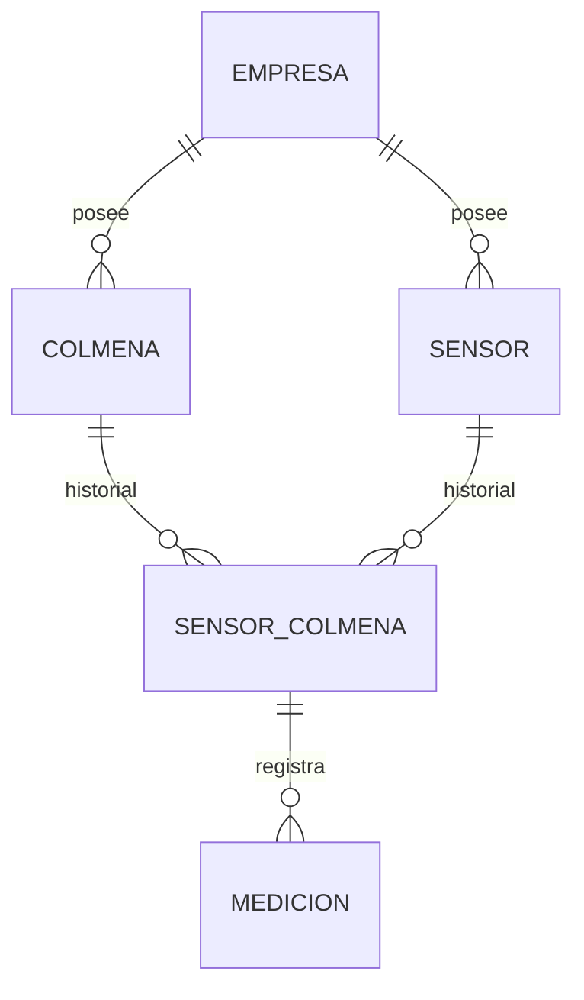

# Modelo de datos, SQL y traslado MK5

## Origen comprobado

En el ZIP MK5 recibido la ruta es `ApiMK5/database/schema.sql`. Se tomó ese modelo, no un diseño apícola genérico. El archivo antiguo contiene 19 tablas de dominio, triggers y órdenes de administración que incluyen eliminación de base/usuarios; no debe ejecutarse indiscriminadamente.

El esquema MK6 tiene 31 tablas contando las técnicas de Django y 22 triggers. El archivo `database/schema_mk6.sql` se obtiene de una base vacía creada por las migraciones, incluye sus semillas/historial y fue restaurado en otra base de prueba. No contiene empresas, usuarios, contraseñas o mediciones de clientes, ni órdenes DROP DATABASE. No es un respaldo de tus datos reales.

## Cambios del modelo

| Tabla/entidad MK5 | Tratamiento MK6 |
|---|---|
| empresas | Conservada: NIT único, información, estado y fechas. Bloqueo por empresa para asignar cupos/números. |
| roles, permisos, roles_permisos | Conservados como Rol, Permiso y relación M2M de Django; nombres de cuatro roles. Permisos normalizados a la matriz nueva. |
| usuarios | Conservados correo, rol, empresa, estado, nombre y fechas; campos técnicos Django. `es_interno` coherente con rol y nulabilidad de empresa. BCrypt legado compatible. |
| planes_suscripcion | Conservada; incorpora max_colmenas y max_sensores, antes inferidos por nombre del plan. |
| suscripciones | Conservada con índice de única activa; cada renovación mantiene registro anterior. |
| pagos | Empresa derivada de suscripción en vez de columna redundante id_empresa; se preservan valor, fecha, revisor, método y referencia. |
| colmenas | PK conservada; agrega numero, numero_historico y archivada. Un número activo por empresa. |
| sensores | Código único por empresa; tipo/empresa/origen estables; agrega identidad externa, cursor, fechas y estado/error de sincronización. |
| sensor_colmena | Conserva las asociaciones y sus intervalos; empresa coherente con ambos objetos. Solo una activa por sensor. |
| monitoreo | Conserva intervalos y único activo por asociación. La activación externa se confirma aparte. |
| rangos_umbrales | Decimal en vez de FLOAT; empresa_norm generado evita umbrales globales duplicados; marca valores globales heredados como demostración. |
| mediciones | Decimal de tres posiciones; conserva asociación/tipo/unidad/origen/fecha; agrega sensor, fecha_recepcion, fuente e id_externo. Identidad por sensor/fuente/ID externo. |
| alertas | Conserva snapshot, estado, resolución y vínculos; único activo por colmena/tipo y uno por medición. |
| notificaciones | Conserva destinatario, empresa, referencias, fecha y leída; bandeja funcional. |
| produccion_miel | Decimal en kg; empresa coherente con colmena; referencia_importacion opcional para no duplicar cosechas importadas. |
| auditoria | Conserva usuario, acción, módulo, entidad, registro_afectado, descripción y fecha. El valor histórico SISTEMA se convierte a PROCESO; no se crea usuario/rol Sistema. |
| solicitudes_suscripcion | Conserva contacto, estado, revisión, plan y cuatro dígitos ficticios; una pendiente por NIT. |
| conexiones_api | Nueva: habilitación, último éxito/error por empresa. Sin token ni URL sensible almacenados en filas. |
| comandos_sensor | Nueva: acción, sensor/asociación, clave idempotente, fecha, intentos, estado y error. |
| importaciones | Nueva: lote, empresa/usuario, nombre, filas normalizadas, errores, resultado y confirmación. |
| Tablas django_* / auth_* / relaciones técnicas | Sesiones, migraciones, content types, permisos técnicos y relaciones del usuario Django. |

La reducción de columnas redundantes no elimina información: por ejemplo, la empresa de un pago se obtiene inequívocamente desde su suscripción. Las PK de entidades heredadas se mantienen al trasladar; Django usa el nombre `id` y nombres de FK `empresa_id`, etc. La tabla de correspondencias está en `migrar_mk5.py`.

## Relaciones principales

Suscripción pertenece a Empresa y Plan; Pago pertenece a Suscripción. Usuario tiene Rol y empresa solo si es cliente. Producción pertenece a Colmena/Empresa; Alerta a Colmena/Empresa y opcionalmente Medición/Sensor; Notificación a Usuario y opcionalmente Alerta/Pago. Monitoreo pertenece a una asociación. Todas estas relaciones se implementan con FK y validaciones complementarias.

## Identidades que no deben confundirse

| Campo | Alcance | ¿Se reutiliza? | Uso |
|---|---|---|---|
| Colmena.id | Global en la BD | No | URL interna, relaciones y hive_id ante API. |
| Colmena.numero | Empresa | Sí, tras archivar | Número mostrado al cliente. |
| Colmena.numero_historico | Registro de colmena | Se conserva | Identificar la colmena archivada que tuvo ese número. |
| Sensor.codigo | Empresa | No se cambia en edición | Identificación visible del dispositivo. |
| Sensor.id_externo | Empresa/proveedor | Estable | Llamadas REST y lectura de cursor. |
| SensorColmena.id | Relación histórica | No | Saber a qué colmena correspondía el sensor en un instante. |
| Medicion.id_externo + fuente + sensor | Fuente y dispositivo | No para eventos distintos | Idempotencia de lecturas. |

No ejecutar `ALTER TABLE ... AUTO_INCREMENT=1` para arreglar números visibles. No renumerar PK ni actualizarlas en cascada. Reutilizar un número visible nunca equivale a reutilizar identidad histórica.

## Restricciones

Los índices garantizan, entre otras, una suscripción activa por empresa, asociación activa por sensor, monitoreo activo por asociación, alerta activa por colmena/tipo, solicitud pendiente por NIT y umbral por empresa/tipo. Los campos generados usan NULL para estados inactivos, permitiendo múltiples filas históricas.

Los 22 triggers (INSERT/UPDATE en once tablas) validan usuarios/rol/empresa; asociaciones; mediciones/sensor/tipo/unidad/origen; producción; alertas; notificaciones; revisor de pagos; comandos; lotes. También mantienen inmutables las identidades empresariales de usuarios, sensores, colmenas y relaciones. Las reglas temporales, cupos y vigencias se comprueban en servicios transaccionales.

Las FK impiden borrar entidades referenciadas. Las bajas normales son lógicas. La importación masiva usa esos mismos servicios/validaciones; no importa SQL libre de un cliente.

## Traslado transaccional

`python manage.py migrar_mk5` lee una copia mediante el alias `legacy`, exige destino sin empresas/usuarios y valida dentro de una transacción que revierte al final. `--aplicar` confirma el traslado. Revisa conteos de 18 tablas de entidades; la relación roles_permisos se reconstruye deliberadamente conforme a los permisos MK6.

El comando adapta nombres, mantiene PK y fechas, asigna números por empresa, convierte valores decimales y marca lecturas MIGRACION_MK5. Conserva registro_afectado en auditoría. No regenera ni inventa mediciones. Prepara órdenes REGISTER para sensores y ACTIVATE para monitoreos heredados que aún cumplan las reglas; la conexión permanece deshabilitada hasta su configuración.

Las fechas se interpretan en America/Bogota por defecto. `--offset-timestamp=-05:00` fija la sesión de lectura MySQL para columnas TIMESTAMP; `--zona-origen` interpreta las fechas ingenuas/DATETIME. Si la instalación original usa UTC, especifica ambos parámetros UTC/+00:00. Para otras zonas históricas o mezclas, realiza una auditoría de fechas antes de aplicar: una zona con horario de verano no siempre se representa con un único desplazamiento fijo.

El origen no se modifica. Si una relación, hash, conteo, estado único o intervalo es incompatible, el comando revierte: se debe revisar la copia y documentar la corrección. No se fusionan silenciosamente alertas/pagos contradictorios ni se descartan filas para hacer pasar la migración.

## Compatibilidad de la copia antigua

En la prueba técnica se construyeron las tablas del SQL aportado con datos sintéticos. MariaDB 11.8 no aceptó el CHECK de auditoría antiguo combinado con `ON DELETE SET NULL`; para esa copia de prueba se usó `ON DELETE RESTRICT`. Esta adaptación de DDL de la copia no alteró los registros ni el código del importador. En el esquema MK6 generado por Django la relación y su restricción son compatibles.

Un dump real puede incluir DEFINER, collation u otras opciones de su servidor. Revísalas al restaurar la copia, no sobre el original. Este paquete prueba el mecanismo de traslado y la estructura recibida; no contiene ni afirma haber migrado los datos de una base productiva que no fue proporcionada como dump con todas sus filas.

## Respaldos

El archivo `schema_mk6.sql` crea una instalación vacía. Un respaldo operativo debe incluir los datos reales (`mysqldump`/`mariadb-dump`, triggers y migraciones). Conserva respaldos fuera del repositorio y prueba restauración en una base diferente. Pasos exactos en `../Ejecutar`.
